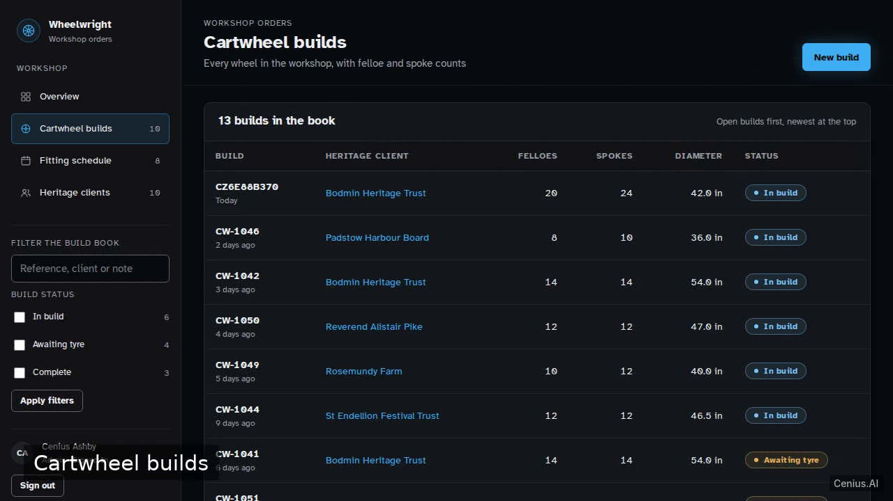
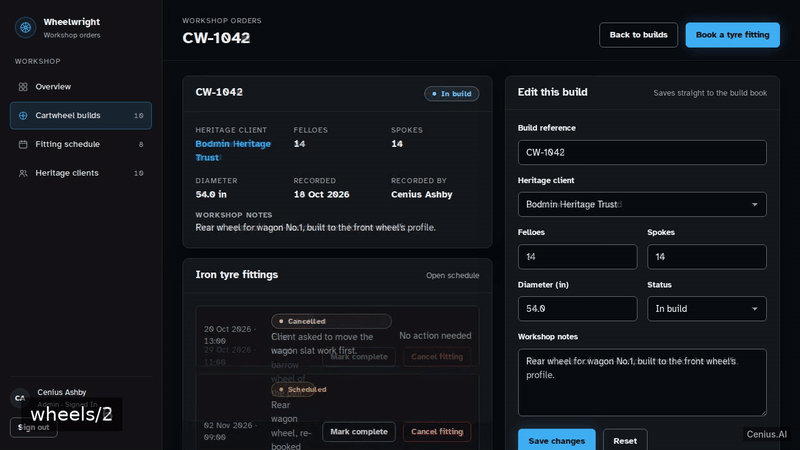
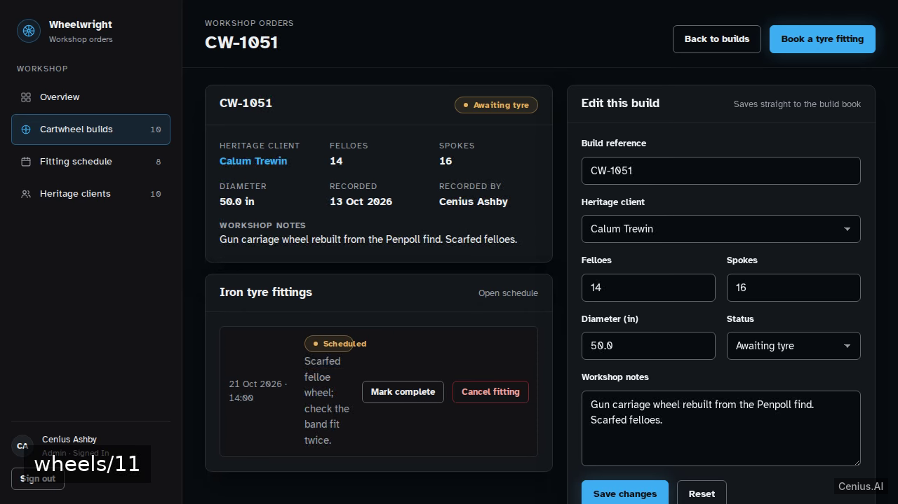
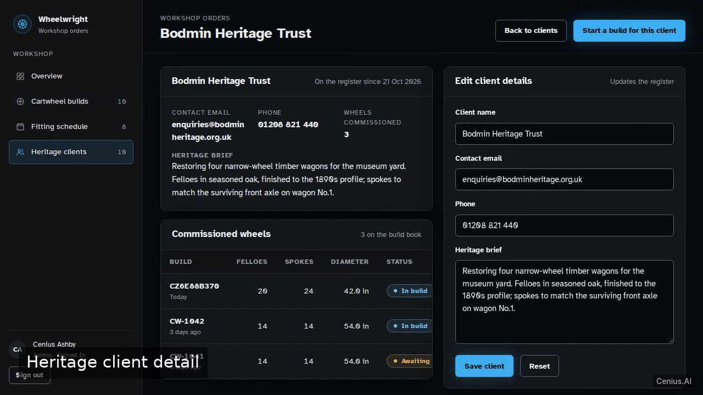
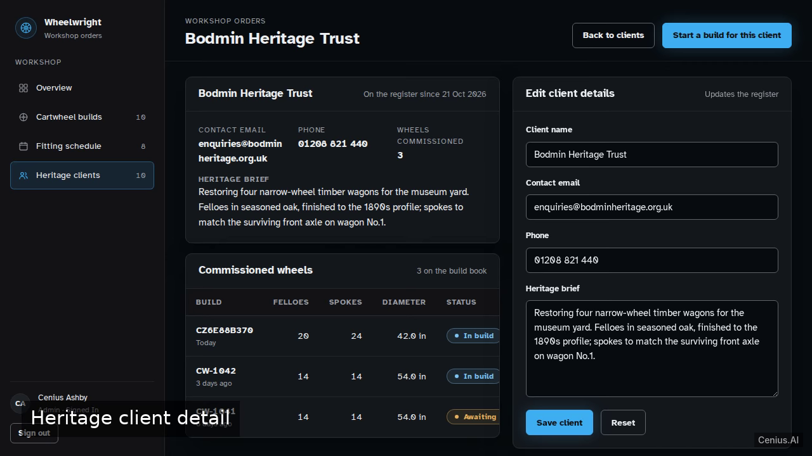

# Wheelwright Workshop Orders — complete FastAPI admin panel example app

Need a self-hosted admin panel? **Wheelwright Workshop Orders** is the open-source answer: a FastAPI project you can clone, run, and own. Wheelwright Workshop Orders is a staff-only internal web app for a traditional wheelwright: staff sign in with their own email/password accounts, record cartwheel builds (felloe count, spoke count, diameter, linked he…. Every Wheelwright Workshop Orders line of code is here — no stripped demo, no paywalled features. Apache-2.0-licensed; [remix Wheelwright Workshop Orders on cenius.ai](https://cenius.ai/marketplace/p/wheelwright-workshop-orders?ref=gh&utm_campaign=wheelwright-workshop-orders-fastapi) for a bespoke custom version.


[](LICENSE)  [](https://cenius.ai)

[](https://cenius.ai/marketplace/p/wheelwright-workshop-orders?ref=gh&utm_campaign=wheelwright-workshop-orders-fastapi)

> **▶ [Open & edit in cenius.ai](https://cenius.ai/marketplace/p/wheelwright-workshop-orders?ref=gh&utm_campaign=wheelwright-workshop-orders-fastapi)** — one click to an editable workspace: describe changes in plain English, get an instant preview, one-click deploy and host. Modifications made on the platform come with full rebrand & relicense rights.

_Local clone? See [Quick start](#quick-start) below. cenius.ai is the zero-setup path._

## Demo





📽 **[Watch the walkthrough](https://cenius.ai/marketplace/p/wheelwright-workshop-orders?ref=gh&utm_campaign=wheelwright-workshop-orders-fastapi)** — plays on cenius.ai · [MP4 file](.github/media/demo.mp4)

## Screenshots

  

## Features

- Staff email/password accounts
- Cartwheel builds with felloe and spoke counts
- Iron tyre fitting schedule
- Heritage commission clients
- Workshop home overview

## Quick start

```bash
./install.sh   # installs dependencies + seeds demo data
```

See [`INSTALL.md`](INSTALL.md) for full setup and usage instructions.

## Usage guide

Sign in at `/login` with `cenius@cenius.ai` / `cenius` (the credential is printed on the sign-in
card, and the "Sign in as the demo wheelwright" button posts it for you). Every workshop page
redirects to sign-in when you are signed out; the header shows who is signed in and carries the
sign-out control.

### Record a cartwheel build

1. Open **Cartwheel builds** in the left rail, then **New build** in the page header.
2. Enter a reference (for example `CW-1053`), pick a heritage client if the wheel belongs to a
   commission, and enter the felloe count (4–20), spoke count (8–24) and diameter in inches.
3. The guidance panel beside the form notes the workshop's typical ranges: 12–14 felloes, 12–16
   spokes.
4. **Save build** lands you on the new build's detail page, and the build appears in the list and in
   the overview's recent builds.

A wrong count returns the form with a message under that field and everything you typed still in
place. The reference must be unique.

### Edit, progress or remove a build

On a build's detail page the right-hand panel edits every field, including status
(*In build* → *Awaiting tyre* → *Complete*). Status changes show immediately on the build page and
in the list, where complete builds are muted. Removing a build is behind a confirmation and takes
its iron tyre fittings with it.

### Book an iron tyre fitting

_Full guide: [`USAGE.md`](USAGE.md)_

## Architecture

Everything runs out of the box: a FastAPI codebase (72 files). `install.sh` takes care of packages and initial data in a single pass; nothing else is required before launching. Top-level layout: `app/`, `scripts/`, `tests/`. Step-by-step setup guide: [`INSTALL.md`](INSTALL.md).

## FAQ

### What's the quickest way to self-host Wheelwright Workshop Orders?

`git clone` + `./install.sh` gets you a running instance — the install script provisions dependencies and demo data. Full steps live in [`INSTALL.md`](INSTALL.md); nothing external is needed to try it.

### Can I rebrand or white-label Wheelwright Workshop Orders?

Yes. You can edit the source directly under the MIT license, or [remix it on cenius.ai](https://cenius.ai/marketplace/p/wheelwright-workshop-orders?ref=gh&utm_campaign=wheelwright-workshop-orders-fastapi) — the platform route grants full rebrand and relicense rights over your derivative.

### What powers Wheelwright Workshop Orders under the hood?

FastAPI. The full source in this repository is exactly what the app runs. Highlights include workshop home overview.

### What if I want to add features to Wheelwright Workshop Orders without coding?

Non-developers can use [cenius.ai](https://cenius.ai/marketplace/p/wheelwright-workshop-orders?ref=gh&utm_campaign=wheelwright-workshop-orders-fastapi) to make changes. Describe your goal in everyday language and the platform delivers an updated, ready-to-run project — zero coding on your part.

### Does the Wheelwright Workshop Orders license allow commercial use?

It is. Apache-2.0 licensing means you can build a product on it, sell it, or use it inside a company with no fees. Details: [LICENSE](LICENSE).

## License & rebranding

Released under the [Apache License 2.0](LICENSE) (© 2026 Cenius AI) — free for personal and commercial use. The Cenius name/logo are trademarks (see NOTICE).

**Need a customized version?** [Remix this app on cenius.ai](https://cenius.ai/marketplace/p/wheelwright-workshop-orders?ref=gh&utm_campaign=wheelwright-workshop-orders-fastapi) — modifications made on the platform come with **full rebrand & relicense rights** over your derivative.

## Built with cenius.ai

This entire application — code, design, seeded demo data — was generated on **[cenius.ai](https://cenius.ai)** from a plain-English description.

- 🚀 [Build your own app on cenius.ai](https://cenius.ai)
- 🎛️ [Remix Wheelwright Workshop Orders on the marketplace](https://cenius.ai/marketplace/p/wheelwright-workshop-orders?ref=gh&utm_campaign=wheelwright-workshop-orders-fastapi) — open it in a workspace, prompt for changes, and ship your own version.

More open-source apps: [the Cenius-ai catalog](https://github.com/Cenius-ai) · [showcase index](https://github.com/Cenius-ai/showcase)
